<p align="center"></p>

<h1 align="center">Pocket Capsule</h1>

<p align="center">Time capsules: seal letters, photos, recordings, predictions, questions and goals until a day you choose — a date, your child's 18th birthday, an anniversary. Sealed means sealed: nobody sees inside until it opens, not even you. Fill one together and keep it a surprise, let grandparents add a letter through a link, send it to the people it is for on the day, and at the opening see then and now, mark which guesses came true and write a letter back. Replaces FutureMe-style letter services with something you keep yourself.<br>One Go binary, one SQLite file, one volume. Part of the Pocket apps; works on its own too.</p>

<p align="center">
  <a href="https://github.com/abjelosevic88/pocket-homelab-capsule/actions/workflows/ci.yml"></a>
  <a href="https://github.com/abjelosevic88/pocket-homelab-capsule/pkgs/container/pocket-homelab-capsule"></a>
  <a href="LICENSE"></a>
</p>

<p align="center">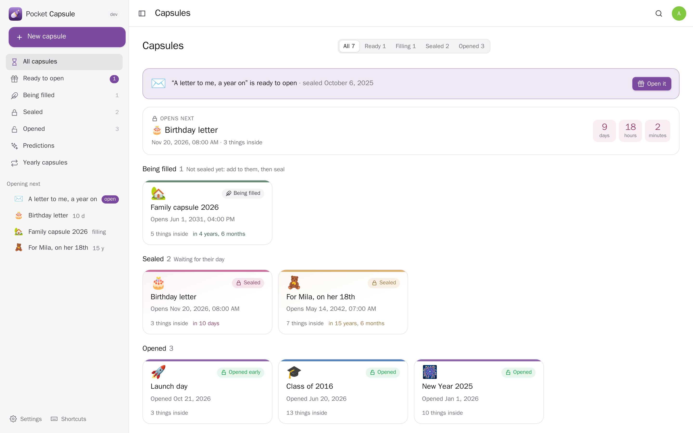</p>

<table>
  <tr>
    <td width="50%">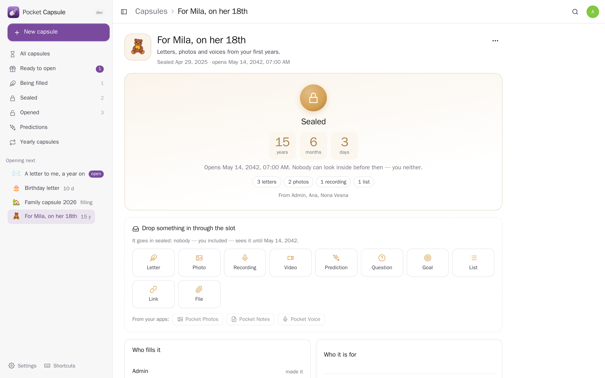</td>
    <td width="50%">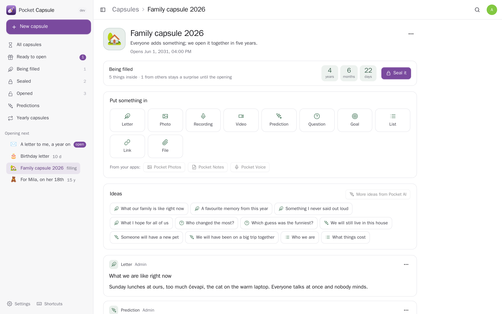</td>
  </tr>
  <tr>
    <td align="center"><sub>Sealed: a countdown and how many things are inside — nothing more, not even for its maker.</sub></td>
    <td align="center"><sub>Being filled together: everyone sees only their own until it opens.</sub></td>
  </tr>
  <tr>
    <td width="50%">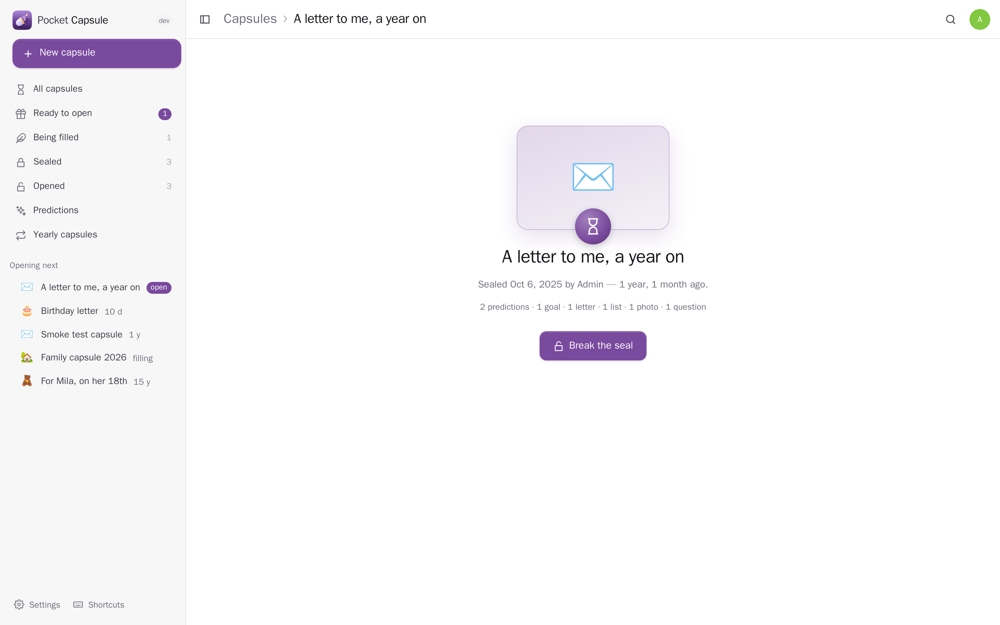</td>
    <td width="50%">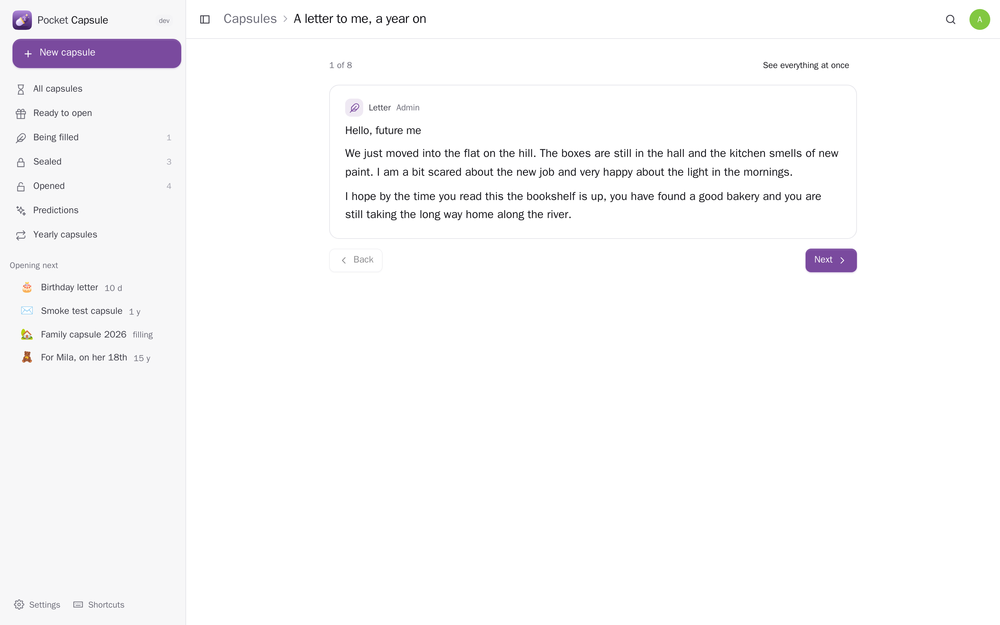</td>
  </tr>
  <tr>
    <td align="center"><sub>Its day: break the seal…</sub></td>
    <td align="center"><sub>…and what is inside comes one thing at a time.</sub></td>
  </tr>
  <tr>
    <td width="50%">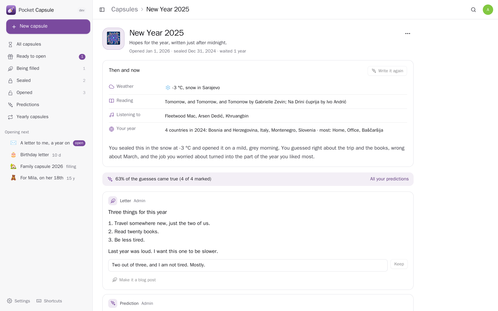</td>
    <td width="50%">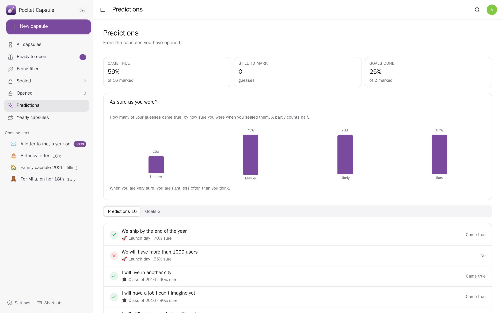</td>
  </tr>
  <tr>
    <td align="center"><sub>Opened: the world of sealing day next to today, guesses to mark, questions to answer.</sub></td>
    <td align="center"><sub>Every guess you ever sealed — are you right as often as you are sure?</sub></td>
  </tr>
</table>

<table>
  <tr>
    <td width="25%">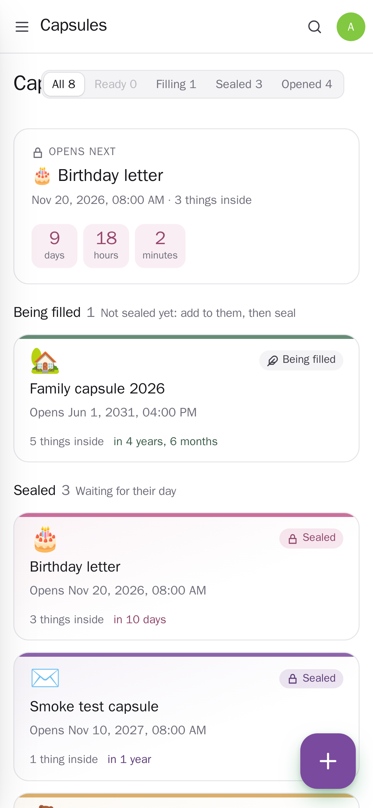</td>
    <td width="25%">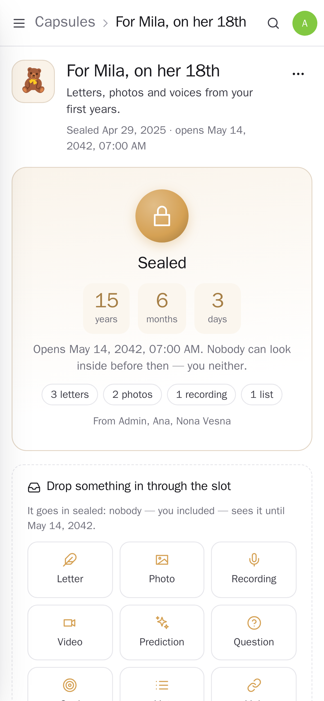</td>
    <td width="25%">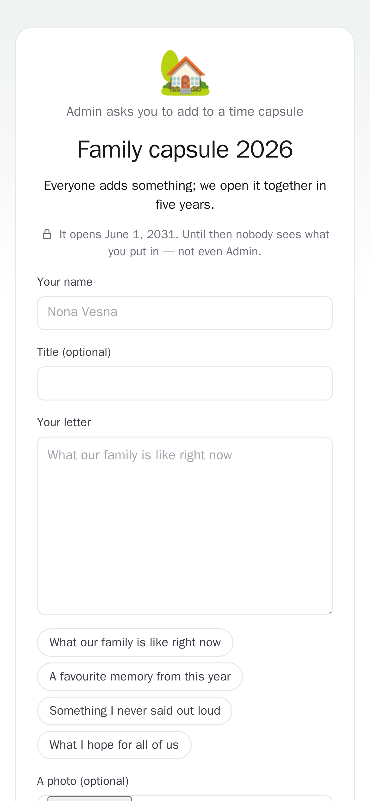</td>
    <td width="25%">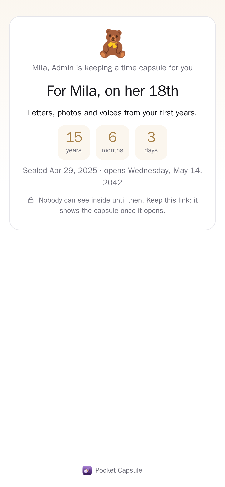</td>
  </tr>
</table>

## What it does

- **Capsules for every occasion.** A letter to future you, a New Year's capsule, one for your child that opens on their 18th birthday, a family or team capsule, a birthday letter, an anniversary — each kind comes with things to write about, questions, guesses and lists ("what things cost", "right now").
- **Ten kinds of thing inside.** Letters (with an optional helping hand from Pocket AI that never makes facts up), photos, recordings made in the browser, videos, files, predictions with how sure you are, questions for whoever opens it, goals, lists and links. Pictures, recordings and files are kept in the capsule itself — it has to outlive the apps they came from.
- **Sealed means sealed.** Once sealed, no page, search, admin or other app shows what is inside until the day — its maker included. The slot can stay open: things can still be dropped in, unseen. Breaking the seal early takes typing *open*, and stays on record.
- **Together.** People on the box add to it; with *keep it a surprise* everyone sees only their own. People without an account add a letter and a photo through a link (ten an hour per address). Each person it is for gets their own link: a countdown before, the whole capsule after — sent by email when it opens, or on the day itself.
- **The world of the day.** When you seal it, it keeps the weather, what you were reading and listening to, the countries and places of your year (and, only if you pick them, steps and sleep, net worth) from your other Pocket apps. On the opening day the same facts are read again: *then and now*, with a short write-up by Pocket AI if you like.
- **The opening.** A notification (and Pocket Alerts) when the day comes and a reminder before; a small ceremony that reveals one thing at a time; then mark what came true, answer the questions, turn unfinished goals into tasks, write back to the past, keep it as a note or a folder in Pocket Files, and start the next one.
- **Predictions.** Every guess from every opened capsule, how many came true, and whether you are right as often as you are sure.
- **Yearly capsules.** On New Year's Eve or your birthday, a nudge to write this year's.
- **Your data.** Export everything as JSON with the files (sealed contents packed so a glance does not spoil them; importing twice changes nothing), a CSV of your capsules, and the whole SQLite database for admins.

## Run it

```sh
docker run -d --name pocket-capsule -p 8080:8080 -v ./data:/data \
  -e BASE_URL=https://capsule.example.com -e SECURE_COOKIES=true \
  ghcr.io/abjelosevic88/pocket-homelab-capsule:latest
```

Open it and make the first account (that one is the admin). To try it with made-up capsules: `DEMO_DATA=true AUTH_MODE=none`. Release binaries for Linux, macOS, Windows and FreeBSD are on the releases page. Settings: [docs/configuration.md](docs/configuration.md), API: [docs/api.md](docs/api.md), backup: [docs/backup.md](docs/backup.md), reverse proxy: [docs/reverse-proxy.md](docs/reverse-proxy.md).

## With Pocket Core

Set `CORE_URL` and `CORE_REGISTRATION_KEY` and Capsule joins the box: people sign in with Pocket Core, Pocket AI helps, and through app links (each person switches them on) it reaches the other Pocket apps — every one optional, greyed out with what to do when it is not there:

| App | What for | Scopes |
|---|---|---|
| Pocket Calendar | the opening day in your calendar when you seal it | `calendar:write` |
| Pocket Contacts | who it is for, and birthdays / anniversaries to open on | `contacts:read` |
| Pocket Family | your child's birthday for an 18th-birthday capsule | `family:read` |
| Pocket Email | send it to the people it is for; ask family to add a letter | `mail:send` |
| Pocket Chat | tell a chat it is sealed or opened | `chat:read`, `chat:write` |
| Pocket Photos | copies of your photos inside | `photos:read` |
| Pocket Notes | a note inside; an opened capsule as a note | `notes:read`, `notes:write` |
| Pocket Files | a copy of an opened capsule with all its files | `files:write` |
| Pocket Voice | a voice memo (recording and what was said) inside | `voice:read` |
| Pocket Tasks | a goal from an opened capsule as a task | `tasks:write` |
| Pocket Alerts | ready to open, opening soon, a yearly capsule to write | `alerts:write` |
| Pocket Blog | a letter from an opened capsule as a post draft | `blog:write` |
| Pocket Weather, Bookshelf, Music, Movement | the world of the day: weather, reading, listening, your year | `weather:read`, `books:read`, `listening:read`, `movement:read` |
| Pocket Health, Wealth | steps, sleep and weight; net worth — only when you pick them | `health:read`, `wealth:read` |

Other apps use your capsules through `capsule:read` (the outside of every capsule, what is inside the opened ones — Pocket Day, Search, AI) and `capsule:write` (start one and put things in, also through the slot — Pocket Voice, Photos, AI; never seal or open). Events for Pocket Flows: `capsule.sealed`, `capsule.ready`, `capsule.opened`, `capsule.item_added`.

## Develop

```sh
make run      # build the web app and the binary, start with demo data on :8080
make dev      # Go server + Vite dev server
make test     # go vet, go test, tsc
```

Go 1.26, `modernc.org/sqlite` (no CGO), chi; React 19, TypeScript, Vite. `scripts/screenshots.mjs` takes the README pictures and walks through making, sealing and opening a capsule in a real browser.

MIT © 2026 Aleksandar Bjelosevic
